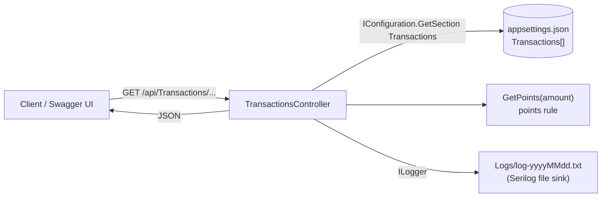

# Reward Points API


An ASP.NET Core Web API that calculates customer reward points from purchase transactions. I wrote it in December 2022, during my master's program, as a take-home exercise. In October 2026 I moved it to .NET 10, fixed two bugs in the per-month endpoint, and moved the tests into this repo. Apart from that it is still the original exercise.

## Problem

A retailer gives customers reward points for every purchase:

- **1 point** for every whole dollar spent over **$50** in a transaction, plus
- **1 more point** for every whole dollar spent over **$100** in the same transaction.

So a dollar above $100 is worth 2 points and a dollar between $50 and $100 is worth 1. Given a set of transactions, the API reports points per customer per month and the total for each customer.

The rule is implemented in `GetPoints` in [`Controllers/TransactionsController.cs`](Controllers/TransactionsController.cs):

```csharp
if (amount > 50)  points += (int)(amount - 50);
if (amount > 100) points += (int)(amount - 100);
```

### Worked example

These numbers come from the sample data in `appsettings.json`, and the API returns the same values (checked locally, see [Verification](#verification)).

| Customer | Month | Transaction | Over $50 | Over $100 | Points |
|---|---|---|---|---|---|
| Jane Doe | 1 | $120 | 70 | 20 | 90 |
| Jane Doe | 1 | $80 | 30 | 0 | 30 |
| Jane Doe | 2 | $200 | 150 | 100 | 250 |

- January for Jane Doe: 90 + 30 = **120**
- February for Jane Doe: **250**
- Total for Jane Doe: **370**

Boundary values, all covered by tests: $50 earns 0 points, $51 earns 1, $100 earns 50, $101 earns 52 and $120 earns 90. Each tier is truncated separately, so $100.75 earns 50 points.

## Architecture

The whole app is one controller. It reads transactions from the `Transactions` section of `appsettings.json` through `IConfiguration`, which serves as the data store. It then filters and groups them with LINQ and returns JSON. There is no database, service layer or authentication.



### Project structure

```
RewardPointsAPI_StandAlone/
├── Controllers/
│   └── TransactionsController.cs   # all 4 endpoints + the points rule
├── Models/
│   ├── Transaction.cs              # Customer, Month, Amount, GetMonthName
│   ├── RewardPoints.cs             # Customer, Month, Points
│   └── RewardPointsTotal.cs        # Customer, Points
├── Properties/launchSettings.json  # https://localhost:7161, http://localhost:5161
├── Program.cs                      # generic host -> Startup
├── Startup.cs                      # controllers, Swagger, file logging
├── appsettings.json                # logging config + sample transactions
├── Dockerfile                      # Visual Studio-generated multi-stage build
├── tests/
│   └── RewardPointsAPITest/        # NUnit tests (unit + in-memory HTTP)
└── RewardPointsAPI_StandAlone.sln  # API + test project
```

Packages: `Swashbuckle.AspNetCore` 10.3.1, `Serilog.Extensions.Logging.File` 3.0.0, `Microsoft.VisualStudio.Azure.Containers.Tools.Targets` 1.23.0.

## Prerequisites

The project targets **`net10.0`** (.NET 10, LTS). You need the [.NET 10 SDK](https://dotnet.microsoft.com/download/dotnet/10.0). It was checked with SDK 10.0.301.

## Build and run

```bash
git clone https://github.com/HariVenkataKrishnaKotha/RewardPointsAPI_StandAlone.git
cd RewardPointsAPI_StandAlone
dotnet build RewardPointsAPI_StandAlone.sln
dotnet run --project RewardPointsAPI_StandAlone.csproj
```

`dotnet run` uses the `RewardPointsAPI_StandAlone` profile in `Properties/launchSettings.json` (`--launch-profile RewardPointsAPI_StandAlone` selects it explicitly). It listens on:

- `https://localhost:7161`
- `http://localhost:5161`, which redirects to HTTPS (`307`) because `UseHttpsRedirection` is on

**Swagger UI:** <https://localhost:7161/swagger>

Swagger is enabled in every environment, not only Development (`Startup.cs`).

Log output goes to `Logs/log-<yyyyMMdd>.txt` next to the app's binaries (for `dotnet run`, that is `bin/Debug/net10.0/Logs/`).

## API endpoints

The base route is `/api/Transactions`. ASP.NET Core routing ignores case, so `/api/transactions` works too. Every endpoint is `GET` and anonymous.

| Endpoint | Query parameters | Returns |
|---|---|---|
| `/api/Transactions` | none | Every transaction in config |
| `/api/Transactions/rewardpoints` | `customerName` (optional), `monthName` (optional) | Points per customer per month. Omit `customerName` for all customers, omit `monthName` for all months |
| `/api/Transactions/rewardpoints/total` | `customerName` (optional) | Total points per customer. Omit `customerName` for all customers |
| `/api/Transactions/health` | none | `200 OK`, empty body |

Matching on `customerName` and `monthName` ignores case. `monthName` is a full month name such as `January` (current culture). Rows are returned in the order their customer and month first appear in the data.

The responses below were captured from a local run against the sample `appsettings.json`.

### `GET /api/Transactions`

```bash
curl -k https://localhost:7161/api/Transactions
```

```json
[
  {"customer":"Jane Doe","month":1,"amount":120,"getMonthName":"January"},
  {"customer":"Jane Doe","month":1,"amount":80,"getMonthName":"January"},
  {"customer":"Jane Doe","month":2,"amount":200,"getMonthName":"February"},
  {"customer":"Alex Jones","month":2,"amount":150,"getMonthName":"February"},
  {"customer":"Alex Jones","month":3,"amount":90,"getMonthName":"March"},
  {"customer":"Alex Jones","month":3,"amount":60,"getMonthName":"March"},
  {"customer":"Brian Paul","month":1,"amount":36,"getMonthName":"January"},
  {"customer":"Brian Paul","month":3,"amount":135,"getMonthName":"March"},
  {"customer":"Brian Paul","month":3,"amount":98,"getMonthName":"March"}
]
```

### `GET /api/Transactions/rewardpoints`

One customer in one month:

```bash
curl -k "https://localhost:7161/api/Transactions/rewardpoints?customerName=Jane%20Doe&monthName=January"
```

```json
[{"customer":"Jane Doe","month":1,"points":120}]
```

Every customer in one month (`customerName` omitted):

```bash
curl -k "https://localhost:7161/api/Transactions/rewardpoints?monthName=February"
```

```json
[{"customer":"Jane Doe","month":2,"points":250},{"customer":"Alex Jones","month":2,"points":150}]
```

Every month for one customer (`monthName` omitted):

```bash
curl -k "https://localhost:7161/api/Transactions/rewardpoints?customerName=Brian%20Paul"
```

```json
[{"customer":"Brian Paul","month":1,"points":0},{"customer":"Brian Paul","month":3,"points":168}]
```

Every customer and month (no parameters):

```bash
curl -k https://localhost:7161/api/Transactions/rewardpoints
```

```json
[
  {"customer":"Jane Doe","month":1,"points":120},
  {"customer":"Jane Doe","month":2,"points":250},
  {"customer":"Alex Jones","month":2,"points":150},
  {"customer":"Alex Jones","month":3,"points":50},
  {"customer":"Brian Paul","month":1,"points":0},
  {"customer":"Brian Paul","month":3,"points":168}
]
```

A month appears for a customer only if that customer has a transaction in it. A transaction under $50 still produces a row with 0 points, as for Brian Paul in January. If nothing matches, for example `customerName=Alex%20Jones&monthName=January`, the response is `[]`.

### `GET /api/Transactions/rewardpoints/total`

```bash
curl -k "https://localhost:7161/api/Transactions/rewardpoints/total?customerName=Alex%20Jones"
```

```json
[{"customer":"Alex Jones","points":200}]
```

Without `customerName`:

```bash
curl -k https://localhost:7161/api/Transactions/rewardpoints/total
```

```json
[{"customer":"Jane Doe","points":370},{"customer":"Alex Jones","points":200},{"customer":"Brian Paul","points":168}]
```

### `GET /api/Transactions/health`

```bash
curl -k -i https://localhost:7161/api/Transactions/health
# HTTP/1.1 200 OK
```

`-k` is only needed if the ASP.NET Core development certificate is not trusted. To trust it, run `dotnet dev-certs https --trust`.

## Configuration

Transactions live in `appsettings.json`. To try other scenarios, edit the list and restart the app.

```json
"Transactions": [
  { "Customer": "Jane Doe", "Month": 1, "Amount": 120 },
  { "Customer": "Alex Jones", "Month": 2, "Amount": 150 }
]
```

`Month` must be an integer from 1 to 12 and `Amount` must parse as a decimal. The code does not validate either, so a bad value makes the request fail with a 500.

## Docker

The repo has the Dockerfile that Visual Studio generated, now using the `aspnet:10.0` and `sdk:10.0` images. *(not verified: Docker was not available on the test machine, so the build and run were not executed)*

```bash
docker build -t rewardpointsapi-standalone .
docker run --rm -p 8080:8080 rewardpointsapi-standalone
# then open http://localhost:8080/swagger
```

The .NET 8+ container images listen on HTTP port 8080 by default. Inside the container, logs are written to `/app/Logs/`.

## Tests

The tests are in [`tests/RewardPointsAPITest`](tests/RewardPointsAPITest), an NUnit project in the same solution. Run them from the repo root:

```bash
dotnet test RewardPointsAPI_StandAlone.sln
```

Result on the test machine: `Passed!  - Failed:     0, Passed:    18, Skipped:     0, Total:    18`.

The 18 tests cover:

- **Controller (unit):** the three original tests (transaction list, one customer-and-month lookup, one customer total), which mock `IConfiguration` with Moq.
- **Points rule:** $0, $50, $51, $100, $101 and $120 as single transactions, plus two transactions summed in one month.
- **Per-month grouping:** two customers in the same month get separate totals, and one customer gets one row per month.
- **HTTP (in-memory, `WebApplicationFactory`):** `rewardpoints` with `customerName` omitted, `monthName` omitted, both omitted and both given; `rewardpoints/total` with `customerName` omitted; and the health endpoint. These run the real routing, model binding and validation against a fixed set of transactions.

Line coverage measured with `coverlet` (`dotnet test --collect "XPlat Code Coverage"`) is 84% overall and 83% for the controller. Most of the uncovered lines are the `catch`/rethrow blocks.

## Verification

These were checked on 2026-10-27 with a clean build (no `bin`/`obj`) and .NET SDK 10.0.301:

| Check | Result |
|---|---|
| `dotnet build` | Pass. 0 errors, 10 warnings: `CS8604`/`CS8602` (nullable config values) and `CS0169`/`CS8618` (unused `logger` field) |
| `dotnet test` | Pass, 18/18. Line coverage 84% |
| `dotnet run --launch-profile RewardPointsAPI_StandAlone` + all four endpoints + Swagger UI | Pass. Responses as shown above. HTTP on port 5161 redirects to HTTPS with `307` |
| Docker build/run | Not run |

## Known issues

1. **Points truncate per tier.** `(int)` truncation is applied to each tier separately, so fractional amounts lose part of a point. This is fine for whole-dollar data but is not documented as a rule.
2. **Month names depend on culture.** `GetMonthName` uses `CultureInfo.CurrentCulture`, so on a non-English host `monthName=January` matches nothing.
3. **Config values are not validated.** `int.Parse` and `decimal.Parse` run on every request. A malformed row, or a `Month` outside 1-12, causes a 500.
4. **The code has some duplication and dead code.** The config-to-`Transaction` projection is repeated in three actions, and there is an unused `logger` field. These are the source of the build warnings.

## License

MIT. See [`LICENSE.txt`](LICENSE.txt).
